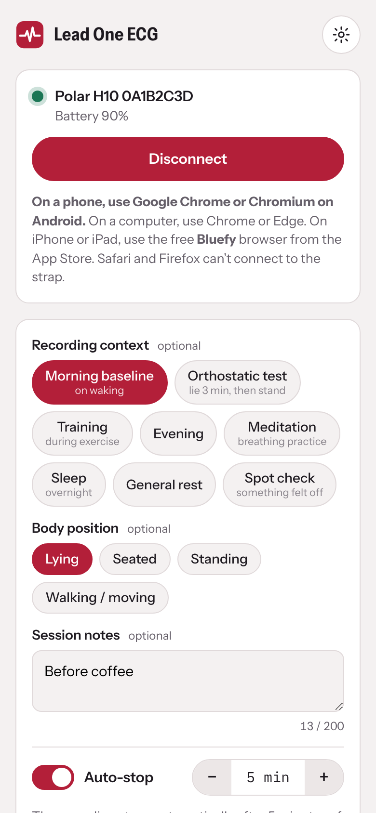
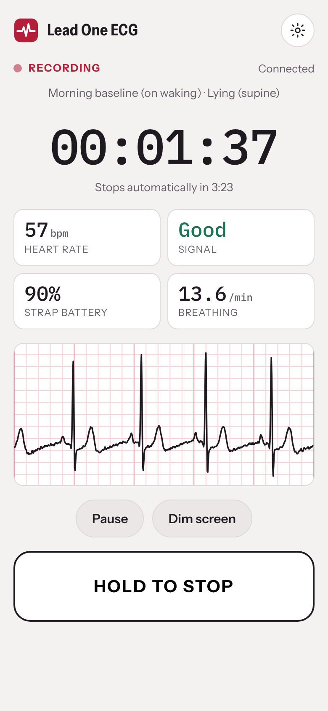
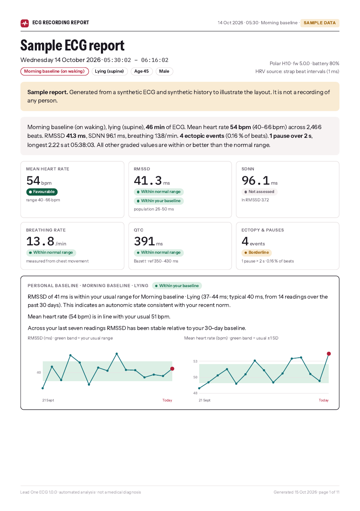
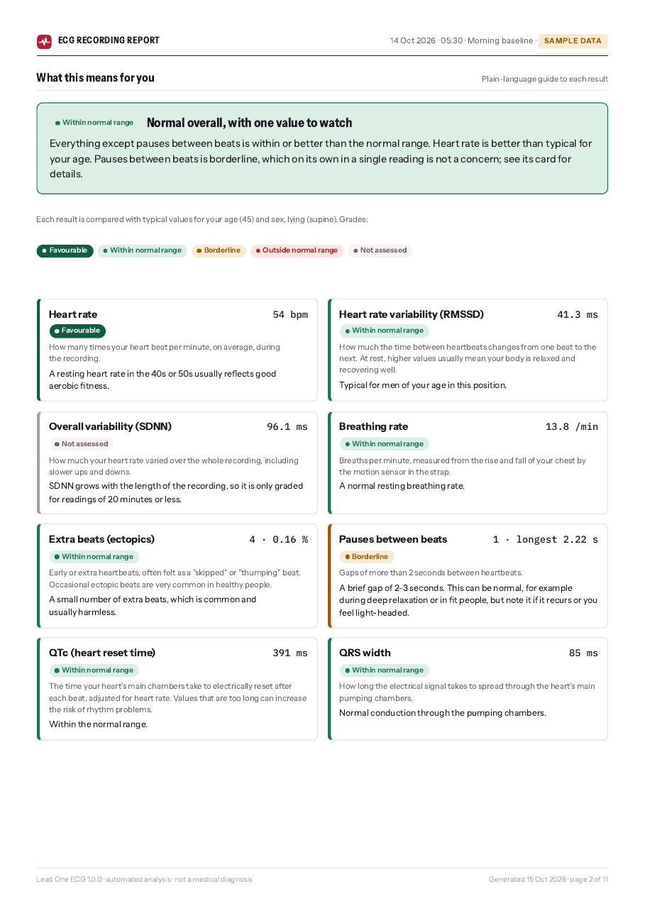

# Lead One ECG

**Open-source single-lead ECG and HRV analysis for chest-strap heart-rate monitors.**
Record with a Polar H10, get a clear, graded A4 report, and track your own baseline over time.
Everything runs in your browser: no account, no server, no data leaves your device.

**Use it now: [leadone.anonacondacodelab.com](https://leadone.anonacondacodelab.com)** (Chrome on Android recommended).

<p>




</p>

> **Not a medical device.** Lead One ECG is for personal, educational and research use. It cannot diagnose or rule out
> heart disease. See the [disclaimer](#disclaimer).

## Features
- **Recording** from a Polar H10 over Web Bluetooth: ECG at 130 Hz, the strap's own beat-to-beat intervals and its
  accelerometer, all at once. Manual stop or auto-stop (1, 2, 2.5, 5, 10 … minutes, up to 8 hours), pause/resume,
  automatic reconnection and minute-by-minute crash-safe storage.
- **Context-aware analysis.** Tag each reading with a context (morning baseline, training, evening, meditation, sleep,
  general rest), a body position and free-text notes. Reference ranges and interpretation adapt to them.
- **Measurements:** heart rate and rhythm, ectopic beats and pauses, RMSSD, SDNN, pNN50/pNN200, SD1/SD2, LF/HF power,
  breathing rate (measured from chest movement), breathing–heart coupling, QRS width, QT/QTc, T-wave shape, J point,
  exercise peak heart rate and heart-rate recovery.
- **A report people can read.** A printable A4 report with a plain-language "What this means for you" page, four-level
  grading (*Favourable · Within normal range · Borderline · Outside normal range*) against age-, sex- and
  position-specific norms, clinician-oriented detail pages and ECG strips on standard 25 mm/s paper.
- **Training analysis.** Working maximum heart rate from your own data (not age formulas), Max HR ramp test and LTHR
  test modes with step cues, threshold zones, and heart-rate recovery measured from the end of exercise with active or
  passive limits.
- **Personal baseline.** After five readings of the same kind, each new reading is compared with your own usual range,
  with trend charts and commentary.
- **Your data stays yours.** History export/import for backups or moving to a new device, with a gentle reminder
  when a backup is due.

## Getting started
The full **[user manual](docs/MANUAL.md)** is also built into the app (home screen → *User manual*).

1. Open **[leadone.anonacondacodelab.com](https://leadone.anonacondacodelab.com)** in **Chrome or Edge** (Android, Windows, macOS, ChromeOS) or Chromium-based browsers with Web Bluetooth
   enabled. It must be served over **https**.
2. On first launch, enter your date of birth and sex (used only for reference ranges, stored only on your device).
3. Moisten the strap electrodes, put the strap on, close other apps connected to it (the H10 streams ECG to one app at a
   time), then **Connect H10 → Start**.
4. When finished, **View report → Save as PDF** (choose "Save as PDF" as the printer).

**Browser support:** Safari and Firefox do not support Web Bluetooth. On Linux, enable
`chrome://flags/#enable-experimental-web-platform-features`; in Brave, enable `brave://flags/#brave-web-bluetooth-api`.
The app explains the fix if Bluetooth is unavailable. Sample reports and recording files work in any modern browser.

### Hosting your own copy
The whole app is one file, `dist/index.html`. Host it anywhere that serves https:
- **Netlify, Cloudflare Pages or similar:** link your fork and set the publish directory to `dist` (no build command).
- **Any static host:** upload `dist/index.html`.
- Set `appUrl` at the top of `build.mjs` to your own address so the in-app help points to it.

Recordings are stored per web address, so moving to a new address starts with empty storage: export your history and
recording files first.

## Privacy and security
- A strict Content Security Policy blocks all network requests; fonts and code are embedded; no analytics or trackers.
- Recordings, history and profile live in your browser's storage on your device. Nothing is uploaded.
- Imported files are validated and all text is escaped before display.

Details and how to report a vulnerability: [SECURITY.md](SECURITY.md).

## How it works
Signal processing, reference ranges and their sources are documented in [docs/METHODS.md](docs/METHODS.md).

## Development
```sh
npm run build   # writes dist/index.html (no dependencies, Node 18+)
npm test        # builds and runs the test suite
```
See [CONTRIBUTING.md](CONTRIBUTING.md). Optional project settings (source-code link, Ko-fi username) are at the
top of `build.mjs`.

## Disclaimer: wellness use only
**Lead One ECG is for general wellness, fitness and education only. It is not a medical device.**

- It has not been evaluated, cleared or approved by any medical regulator (such as the FDA, the EU MDR bodies or the Thai FDA).
- It must **not** be used to diagnose, treat, rule out or monitor any illness or heart condition, or to make decisions
  about medicines or treatment.
- A consumer chest strap records a single ECG lead and cannot detect many conditions that a clinical 12-lead ECG or longer
  monitoring can. Automated analysis can be wrong. A normal result does not mean your heart is healthy.
- Reference ranges are for adults.

It is experimental software provided "as is", without warranty of any kind (see [LICENSE](LICENSE)). The app asks every
user to acknowledge this before first use. **If you have chest pain, fainting, severe shortness of
breath, or a racing or very irregular heartbeat, seek medical care immediately.**

## Trademarks
Polar and H10 are trademarks of Polar Electro Oy. This project is independent and not affiliated with or endorsed by
Polar Electro. See [NOTICE.md](NOTICE.md) for third-party licences.

## Licence
Copyright © 2026 Anonaconda Code Lab.

Lead One ECG is free software: you can redistribute it and/or modify it under the terms of the
[GNU General Public License](LICENSE) as published by the Free Software Foundation, either version 3 of the License, or
(at your option) any later version. In short: you may use, study, share and change it, and even sell copies, but any
version you distribute, including a modified one or an app built from this code, must be released under the same licence
with its full source code.

This program is distributed in the hope that it will be useful, but WITHOUT ANY WARRANTY; without even the implied
warranty of MERCHANTABILITY or FITNESS FOR A PARTICULAR PURPOSE. See the GNU General Public License for more details.

The embedded fonts keep their own licence (SIL Open Font License 1.1); see [NOTICE.md](NOTICE.md).
